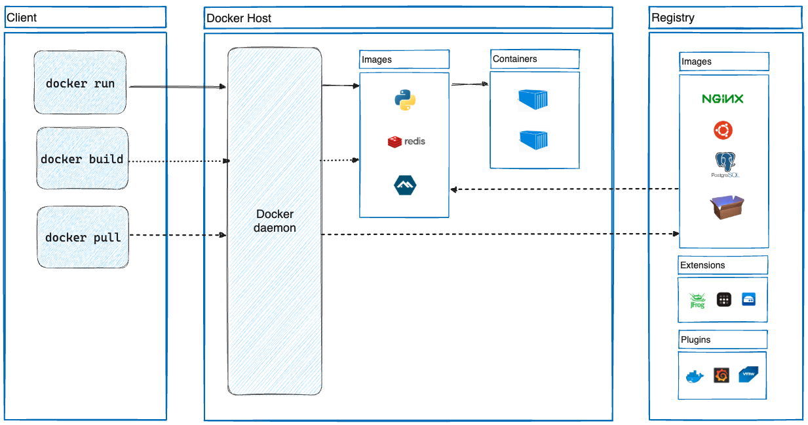

# Container Contract

Follow one request from your terminal to the API running inside Docker. By the
end, you should be able to identify which part of that path failed when a
request does not reach the model.



*Source: [Docker architecture](https://commons.wikimedia.org/wiki/File:Docker-architecture.png), Wikimedia Commons; CC BY-SA 4.0, by dc.*

## Read The Container Configuration

The [Dockerfile](Dockerfile) installs dependencies from `uv.lock`, copies
`src/`, and starts Uvicorn as a non-root user. An **image** packages those
files and the startup command; a **container** is a running instance of it.
The [Compose file](docker-compose.yaml) supplies runtime settings and connects
the container to your machine:

| Setting | Why it matters |
|---|---|
| `--host 0.0.0.0 --port 8000` | Uvicorn accepts traffic on the container's network interfaces. |
| `127.0.0.1:8000:8000` | Compose forwards port 8000 on your machine to port 8000 in the container. Only your machine can reach the published host port. |
| `env_file` and `MODEL_PROVIDER` | Runtime configuration stays separate from the image. The shell override below selects the stub. |
| `healthcheck` | A request made inside the container checks whether `/health` responds. It does not generate text. |

## Start The Local Service

Run from the repository root after [setup](README.md#setup). Keep port 8000
free; stop any earlier Uvicorn process you started for this lesson.

```bash
MODEL_PROVIDER=dry docker compose up --build --wait
docker compose ps
```

Expect the `api` container to be running and healthy. The first build can take
longer while Docker downloads the base image and dependencies. If the service
does not start, inspect `docker compose logs api` before retrying. Keep the
container running for the later local walkthroughs.

## Verify The API

```bash
curl -i http://127.0.0.1:8000/health
curl -i http://127.0.0.1:8000/ready
curl -i -X POST http://127.0.0.1:8000/generate \
  -H "Content-Type: application/json" \
  -d '{"prompt":"Explain container readiness briefly."}'
```

| Request | Expected evidence | What it proves |
|---|---|---|
| `GET /health` | HTTP 200, `{"status":"healthy"}` | The process and HTTP route respond. |
| `GET /ready` | HTTP 200, `"provider":"dry"`, and a configured model | The app initialized with the intended configuration; no provider call was made. |
| `POST /generate` | HTTP 200, nonempty `text`, and a `dry:` model | The generation path returns a typed response through the stub. |

In [app.py](src/deployment_service/app.py), FastAPI validates the request
against [GenerateRequest](src/deployment_service/models.py) before calling the
handler. The handler delegates to [GenerationService](src/deployment_service/service.py),
which checks the cache and calls the provider only on a miss.

```bash
curl -i -X POST http://127.0.0.1:8000/generate \
  -H "Content-Type: application/json" \
  -d '{"prompt":"   "}'
```

Expect HTTP 422. The contract strips whitespace and rejects the empty prompt
before the generation handler runs. This is different from a failed model
request, which reaches the handler and is mapped to a service error.

## Practice

Predict what changes if Uvicorn listens only on `127.0.0.1` **inside** its
container. Try a temporary second container from the same image:

```bash
MODEL_PROVIDER=dry docker compose run --rm -p 127.0.0.1:8001:8000 api \
  uv run --no-sync uvicorn deployment_service.app:app --app-dir src \
  --host 127.0.0.1 --port 8000
```

Once Uvicorn has started, try `curl -i http://127.0.0.1:8001/health` from another
terminal. Expect a connection error or empty reply, not an HTTP health
response. Compare it with the working port 8000. Stop the temporary
container with Ctrl+C; the main Compose service remains available.

## Reference Answer

<details>
<summary>Show Reference Answer</summary>

A process bound to container loopback accepts traffic only from inside that
container. Binding to `0.0.0.0` allows the container network interface to
receive traffic forwarded through the published port or cloud load balancer.

</details>

## Check Your Understanding

1. Does a successful `/health` response establish that inference works?
2. Why should a readiness probe avoid a paid model call?

<details>
<summary>Show Reference Answers</summary>

1. No. It establishes HTTP liveness; inference needs a separate check.
2. Repeated probes would consume quota and money. This service checks configuration, not upstream availability.

</details>
