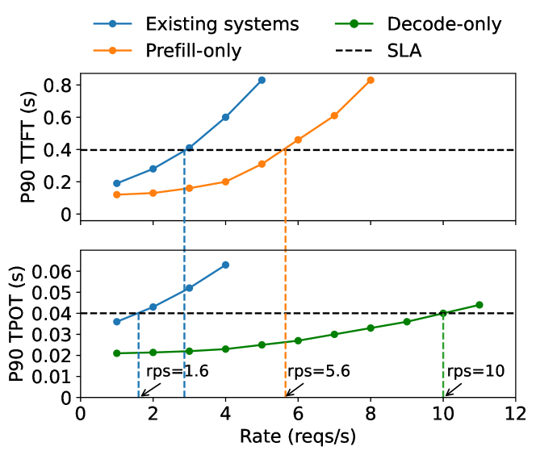
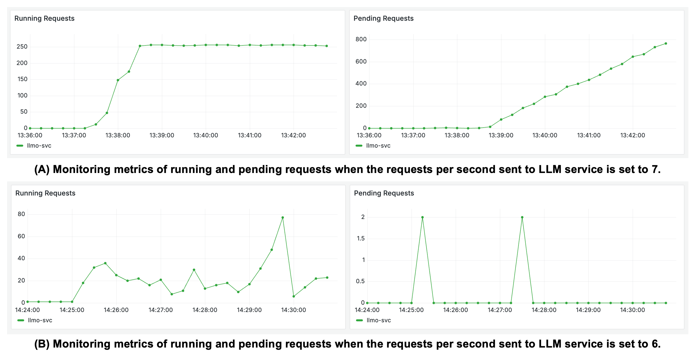

# Scaling And Failure Diagnosis

The default Blueprint uses one instance to keep the exercise predictable.
`deployment/render.autoscaling.example.yaml` shows the paid autoscaling fields
without enabling them accidentally. Render autoscaling requires a Pro workspace
and bills every active instance.

Copy the `scaling` block into the main Blueprint and remove `numInstances`;
keep its provider settings and secret configuration. The example is not a
complete replacement. The workspace subscription and the service's `plan`
(instance size) are separate choices.



*Research context: Figure 1 from [DistServe: Disaggregating Prefill and Decoding for Goodput-optimized Large Language Model Serving](https://arxiv.org/abs/2401.09670), licensed [CC BY-SA 4.0](https://creativecommons.org/licenses/by-sa/4.0/). The chart shows why a service can cross a latency target before its raw throughput is exhausted. This repository keeps the implementation on one small container; the figure is here to support the capacity discussion, not as an implementation requirement.*



*Source: Figure 1 from [ENOVA: Autoscaling towards Cost-effective and Stable Serverless LLM Serving](https://arxiv.org/abs/2407.09486).*

## Practice

Start the local API in one terminal, then run the load probe against dry mode
from another:

```bash
uv run uvicorn deployment_service.app:app --app-dir src
```

```bash
uv run python scripts/load_test.py --requests 30 --concurrency 6
```

Interpret throughput, p95 latency, and error rate. Then diagnose each symptom:

The probe reuses three prompts, so it measures a cache-heavy workload, not raw
model capacity. p95 uses the nearest-rank definition; transport failures count
as errors rather than aborting the run. Stub-mode timings are not live inference
benchmarks.

`throughput_rps` counts all completed attempts, including failures;
`successful_throughput_rps` counts only 2xx responses. Mean and p95 latency
include failed requests and exclude time waiting for the probe's own semaphore.
A fast failure can improve these timings without improving useful service.

- requests end at the platform timeout;
- memory rises until instances restart;
- health checks pass while generation returns `502`; and
- p95 latency rises but CPU remains low.

## Reference Answer

<details>
<summary>Show Reference Answer</summary>

Check queueing and upstream latency first. The application returns `504` when
its total queue-plus-generation deadline expires; other provider failures return
`502`. Smaller workloads or concurrency changes may help; streaming changes
the API contract rather than removing the need for deadlines.
Memory restarts indicate an instance-size or in-process-model problem. Passing
health with provider failures means liveness is correct but upstream readiness
or alerting is incomplete. High latency with low CPU usually points to waiting
on an external provider, so adding instances may not fix the bottleneck.

</details>

## Check Your Understanding

1. Can a higher total request rate coexist with a complete outage?
2. Does this cache-heavy dry-mode probe measure LLM serving capacity?

<details>
<summary>Show Reference Answers</summary>

1. Yes. Failed requests also complete; inspect successful throughput and error rate.
2. No. It measures this application's stub and cache path, not model inference capacity.

</details>
