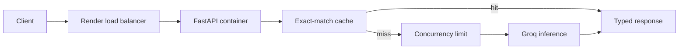

# Containerized LLM Deployment

This repository teaches how to package an asynchronous LLM API in Docker and
deploy it to [Render](https://render.com/docs) with explicit health checks,
resource, scaling, caching, and cost decisions. The service runs locally in
deterministic dry mode and can use [Groq](https://console.groq.com/docs/openai)
with `openai/gpt-oss-20b` for intentional live inference.

Please use this repository as a template when starting your deployment project.

## Learning Objectives

By completing this repository, you should be able to:

- Deploy a containerized LLM API to Render with explicit resource, health, and
  secret configuration.
- Configure and justify manual or automatic scaling for variable inference
  load.
- Diagnose cold starts, memory pressure, provider latency, and request
  timeouts.
- Measure exact-match cache behavior and estimate fixed plus token-based cost.

## Learning Path

- [01-container-contract.md](01-container-contract.md): Run the container and
  inspect its health and readiness contract.
- [02-render-deployment.md](02-render-deployment.md): Deploy the Docker service
  without committing credentials.
- [03-scaling-and-failures.md](03-scaling-and-failures.md): Interpret load
  evidence and diagnose deployment failures.
- [04-caching-and-cost.md](04-caching-and-cost.md): Connect cache hits, token
  usage, instance hours, and cost.

### Additional Folders and Files

| File / Folder | Description |
|---|---|
| [**pyproject.toml**](pyproject.toml) | Project configuration and dependencies. |
| [**uv.lock**](uv.lock) | Dependency lock file. |
| [**.env.example**](.env.example) | Default settings and credential placeholders. |
| [**Dockerfile**](Dockerfile), [**docker-compose.yml**](docker-compose.yml), [**render.yaml**](render.yaml) | Local and hosted deployment. |
| [**Autoscaling example**](deployment/render.autoscaling.example.yaml) | Optional paid scaling configuration. |
| [**Load probe**](scripts/load_test.py) | Throughput, p95 latency and error rate. |
| [**Assets**](assets/README.md) | Visual sources and credits. |

## Required Workflow

Work through the repository in this order:

1. Build and run the container, then inspect `/health`, `/ready`, and
   `/generate`.
2. Deploy the same image to Render with secrets configured outside the image.
3. Run the load probe and diagnose cold starts, memory pressure, provider
   latency, and timeout failures.
4. Compare repeated requests, cache hits, token usage, and cost estimates.
5. Explain whether one instance or autoscaling is justified by the evidence.



## Deliverables

Your repository must include:

- a Docker image that exposes a typed LLM API with health and readiness routes;
- a Render Blueprint with a safe default instance configuration and secrets
  kept outside version control;
- a load probe and written interpretation of throughput, p95 latency, and
  error rate;
- bounded concurrency, timeout handling, exact-match caching, token usage, and
  configurable cost estimation; and
- answers to the four practice tasks in the numbered implementation files.

## Setup

Use [uv](https://docs.astral.sh/uv/getting-started/installation/) 0.13.5 or newer
and Python 3.13.17 or a newer 3.13 patch release, as defined in
[`.python-version`](.python-version).

Rebuild existing Docker images with `--pull --no-cache` after this update
to refresh their system certificates and dependencies.

> [!NOTE]
> Throughout these steps, text in angle brackets like `<repo-name>` is a **placeholder**. Replace it, including the `< >` brackets, with your own value. For example, `cd <repo-name>` becomes `cd mle-containerized-llm-deployment`.

### 1. Create the Repository from the Template

Click **Use this template** on GitHub.

When creating the repository:

- Set yourself as the **Owner**
- Choose a repository name
- Disable **Include all branches**
- Click **Create repository**

> [!IMPORTANT]
> If you are working in pairs or groups, only **one person** should complete this step.

---

### 2. Add Collaborators (Pairs/Groups Only)

If working with teammates:

1. Open the repository on GitHub
2. Go to **Settings → Collaborators**
3. Add your teammates as collaborators
4. Share the repository link with your team

Teammates should accept the invitation before continuing.

---

### 3. Clone the Repository

Copy the SSH URL from the **Code** button on GitHub, then run:

```bash
git clone <copied-ssh-url>
```

The copied SSH URL will look like `git@github.com:<your-username>/<repo-name>.git`.

---

### 4. Move into the Project Folder and Install Dependencies

The command below installs all dependencies and creates a virtual environment in `.venv/`.

```bash
cd <repo-name>
uv sync
```

Python 3.13 is selected by `.python-version`. Install [uv](https://docs.astral.sh/uv/getting-started/installation/) first if needed.

---

### 5. Set Up Environment Variables

```bash
cp .env.example .env
```

Keep the defaults for the first local run. Never commit `.env` or real credentials.

---

### 6. Open the Repository in VS Code

```bash
code .
```

Select the Python interpreter in `.venv/` and run commands from the repository root.

## Run Locally

```bash
uv run uvicorn deployment_service.app:app --app-dir src --reload
# In another terminal:
uv run pytest
```

Docker Desktop is required for the container exercise. The default `MODEL_PROVIDER=dry` uses a deterministic stub, not an LLM. Set `MODEL_PROVIDER=groq` only for intentional live calls. Both Render examples use paid resources; deploying them can incur charges.

## Useful References

- [Render Blueprint specification](https://render.com/docs/blueprint-spec).
- [Render health checks](https://render.com/docs/health-checks).
- [Render scaling](https://render.com/docs/scaling).
- [FastAPI deployment concepts](https://fastapi.tiangolo.com/deployment/concepts/).
- [Groq OpenAI compatibility](https://console.groq.com/docs/openai).

## Mermaid Diagrams

This repository contains Mermaid diagrams. If you want them to render in VS Code, we recommend installing the `Markdown Preview Mermaid Support` extension:

- [Install in VS Code](vscode:extension/bierner.markdown-mermaid)
- [View on Marketplace](https://marketplace.visualstudio.com/items?itemName=bierner.markdown-mermaid)
