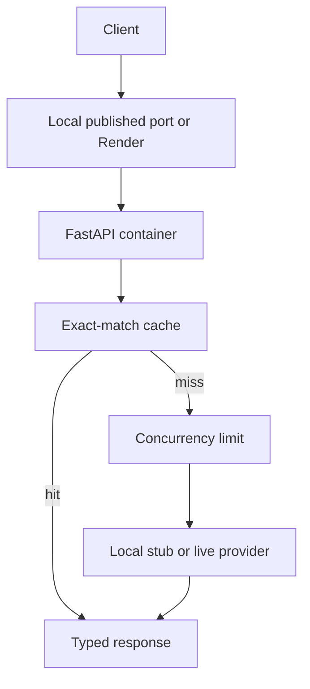

# Containerized LLM Deployment

This repository teaches how to package an asynchronous LLM API in Docker and
deploy it to [Render](https://render.com/docs) with explicit health checks,
resource, scaling, caching, and cost decisions. The API, Dockerfile, and
deployment configuration are supplied. Start with the local stub so you can
observe the service behavior without an API key or cloud account. The hosted
walkthrough can be followed as a configuration review or an instructor demo.

## Learning Objectives

By the end of this repository, you should be able to:

- Deploy a containerized LLM API to Render with explicit resource, health, and
  secret configuration.
- Configure and justify manual or automatic scaling for variable inference
  load.
- Diagnose cold starts, memory pressure, provider latency, and request
  timeouts.
- Measure exact-match cache behavior and estimate fixed plus token-based cost.

## Learning Path



| File / Folder | Description |
|---|---|
| [**01 - Container Contract**](01-container-contract.md) | Run the container and inspect health and readiness. |
| [**02 - Render Deployment**](02-render-deployment.md) | Read the Blueprint and follow the optional hosted verification. |
| [**03 - Scaling and Failures**](03-scaling-and-failures.md) | Interpret load evidence and diagnose deployment failures. |
| [**04 - Caching and Cost**](04-caching-and-cost.md) | Connect cache hits, token usage, instance hours, and cost. |

**First block (01-02):** Build the image, verify the API from the host, and
trace how the same container contract maps to a hosted service.

**Second block (03-04):** Keep the local container running. Compare a healthy
run with a controlled outage, inspect a cache hit, and use the evidence to
decide what you would measure before scaling.

### Additional Folders and Files

| File / Folder | Description |
|---|---|
| [**pyproject.toml**](pyproject.toml) | Project configuration and dependencies. |
| [**uv.lock**](uv.lock) | Dependency lock file. |
| [**.env.example**](.env.example) | Default settings and credential placeholders. |
| [**Dockerfile**](Dockerfile), [**docker-compose.yml**](docker-compose.yml), [**render.yaml**](render.yaml) | Local and hosted deployment. |
| [**Autoscaling example**](deployment/render.autoscaling.example.yaml) | Optional paid scaling configuration. |
| [**Load probe**](scripts/load_test.py) | Throughput, p95 latency and error rate. |
| [**Assets**](assets/README.md) | Visual sources and credits. |

## Prerequisites

Start Docker Desktop or a compatible Docker Engine with Compose before the
[container walkthrough](01-container-contract.md).

> [!NOTE]
> **Windows Users:** The examples use Bash syntax. Run them in Git Bash.

## Setup

Use [uv](https://docs.astral.sh/uv/getting-started/installation/) 0.13.5 or newer
and Python 3.13.17 or a newer 3.13 patch release, as defined in
[`.python-version`](.python-version).

### 1. Create a Copy from the Template (Optional)

If you want your own GitHub copy for experiments, click **Use this template**,
choose an owner and repository name, and leave **Include all branches** off.
For the local walkthrough, you can also clone the lesson directly.

---

### 2. Clone the Repository

```bash
git clone https://github.com/neuefische/mle-containerized-llm-deployment.git
```

If you created your own copy, use its clone URL instead.

---

### 3. Move into the Project Folder and Install Dependencies

```bash
cd mle-containerized-llm-deployment
uv sync --locked
```

If you renamed your copy, use its folder name instead. Run the remaining
commands from this folder. `uv sync --locked` creates `.venv/` using the
Python version selected by `.python-version`.

---

### 4. Set Up Environment Variables

```bash
test -f .env || cp .env.example .env
```

The guides explicitly set `MODEL_PROVIDER=dry` for the local walkthrough.
No keys are needed.

> [!CAUTION]
> Never commit `.env` or real credentials.

---

### 5. Open the Repository in VS Code

```bash
code .
```

Select the Python interpreter in `.venv/` and run commands from the repository root.

## Run Without Docker

For a quick API check, run the same app directly from Python. Use this
instead of the container on port 8000, not alongside it.

```bash
MODEL_PROVIDER=dry uv run --locked uvicorn deployment_service.app:app --app-dir src
```

Use the requests in [step 01](01-container-contract.md#verify-the-api). Stop
the process with Ctrl+C before switching to Docker. Run the isolated test
suite with `uv run --locked pytest`; it does not require Docker or API keys.

For an optional live run, the default provider is Groq. Choose `groq`,
`mistral`, `openrouter`, `google`, or `openai` in `.env` and supply the
matching key and model from [`.env.example`](.env.example). Provider and Render
charges are separate; review pricing and protect public endpoints before
enabling paid inference.

## References & Further Reading

- Render: [Blueprint Specification](https://render.com/docs/blueprint-spec) / [Health Checks](https://render.com/docs/health-checks) / [Scaling](https://render.com/docs/scaling)
- [FastAPI Deployment Concepts](https://fastapi.tiangolo.com/deployment/concepts/)
