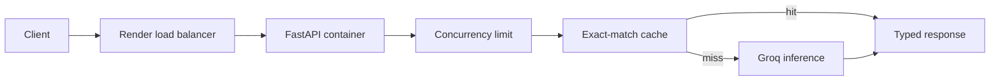

# Containerized LLM Deployment

This repository teaches how to package an asynchronous LLM API in Docker and
deploy it to [Render](https://render.com/docs) with explicit health checks,
resource, scaling, caching, and cost decisions. The service runs locally in
deterministic dry mode and can use [Groq](https://console.groq.com/docs/openai)
with `openai/gpt-oss-20b` for intentional live inference.

Please use this repository as a template when starting your deployment project.

## Learning Path

- [01-container-contract.md](01-container-contract.md): Run the container and
  inspect its health and readiness contract.
- [02-render-deployment.md](02-render-deployment.md): Deploy the Docker service
  without committing credentials.
- [03-scaling-and-failures.md](03-scaling-and-failures.md): Interpret load
  evidence and diagnose deployment failures.
- [04-caching-and-cost.md](04-caching-and-cost.md): Connect cache hits, token
  usage, instance hours, and cost.
- [assets/README.md](assets/README.md): visual assets and source credits.
- [Dockerfile](Dockerfile), [docker-compose.yml](docker-compose.yml), and
  [render.yaml](render.yaml): Local and hosted deployment configuration.
- [deployment/render.autoscaling.example.yaml](deployment/render.autoscaling.example.yaml):
  Paid autoscaling example kept separate from the safe default.
- [scripts/load_test.py](scripts/load_test.py): Throughput, p95 latency, and
  error-rate probe.

## Required Workflow

Work through the repository in this order:

1. Build and run the container, then inspect `/health`, `/ready`, and
   `/generate`.
2. Deploy the same image to Render with secrets configured outside the image.
3. Run the load probe and diagnose cold starts, memory pressure, provider
   latency, and timeout failures.
4. Compare repeated requests, cache hits, token usage, and cost estimates.
5. Explain whether one instance or autoscaling is justified by the evidence.



## Deliverables

Your repository must include:

- a Docker image that exposes a typed LLM API with health and readiness routes;
- a Render Blueprint with a safe default instance configuration and secrets
  kept outside version control;
- a load probe and written interpretation of throughput, p95 latency, and
  error rate;
- bounded concurrency, timeout handling, exact-match caching, token usage, and
  configurable cost estimation; and
- answers to the four checkpoints in the numbered implementation files.

## Environment

The repository uses [uv](https://docs.astral.sh/uv/) and the checked-in lockfile
to create a reproducible environment. The default dry provider requires no API
key.

```bash
uv sync
cp .env.example .env
uv run uvicorn deployment_service.app:app --app-dir src --reload
```

Run the tests with:

```bash
uv run pytest
```

For live inference, set `MODEL_PROVIDER=groq` and add `GROQ_API_KEY` to `.env`.
For the container path, use `docker compose up --build`. Do not commit `.env`,
provider keys, generated reports, or local caches.

Render autoscaling is a paid platform feature. Review the current
[Render scaling documentation](https://render.com/docs/scaling) before applying
the example configuration.

## Learning Objectives

By completing this repository, you should be able to:

- Deploy a containerized LLM API to Render with explicit resource, health, and
  secret configuration.
- Configure and justify manual or automatic scaling for variable inference
  load.
- Diagnose cold starts, memory pressure, provider latency, and request
  timeouts.
- Measure exact-match cache behavior and estimate fixed plus token-based cost.

## Useful References

- [Render Blueprint specification](https://render.com/docs/blueprint-spec).
- [Render health checks](https://render.com/docs/health-checks).
- [Render scaling](https://render.com/docs/scaling).
- [FastAPI deployment concepts](https://fastapi.tiangolo.com/deployment/concepts/).
- [Groq OpenAI compatibility](https://console.groq.com/docs/openai).
