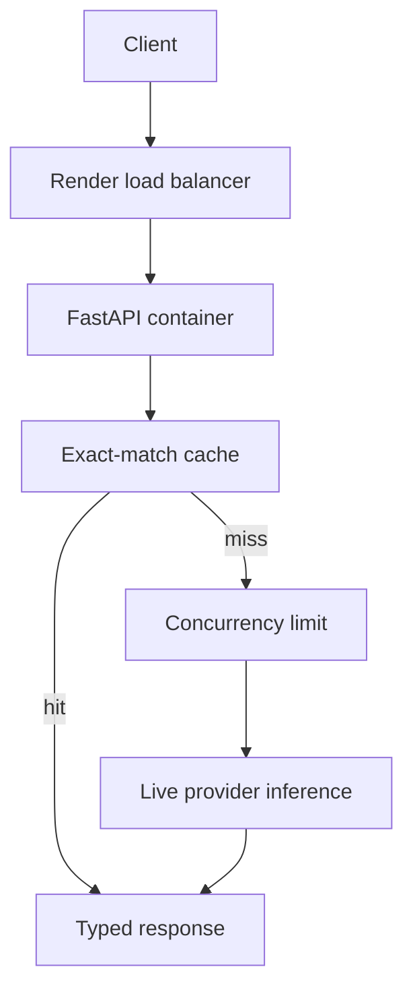

# Containerized LLM Deployment

This repository teaches how to package an asynchronous LLM API in Docker and
deploy it to [Render](https://render.com/docs) with explicit health checks,
resource, scaling, caching, and cost decisions. The service defaults to live
inference using `init_chat_model` with
[Groq](https://console.groq.com/docs/openai) as primary, [Mistral](https://docs.mistral.ai/) as alternative, or optional [OpenRouter](https://openrouter.ai/docs).
OpenRouter defaults to `google/gemma-4-26b-a4b-it:free`, with `openrouter/free` as a server-side backup. Configure both in `.env.example`; free accounts currently share [50 requests/day across free models](https://openrouter.ai/pricing). Responses identify the model actually used.

This guided lesson provides the API, container and deployment files. Work
through the four practice tasks to inspect and adapt them.

## Learning Objectives

By completing this repository, you should be able to:

- Deploy a containerized LLM API to Render with explicit resource, health, and
  secret configuration.
- Configure and justify manual or automatic scaling for variable inference
  load.
- Diagnose cold starts, memory pressure, provider latency, and request
  timeouts.
- Measure exact-match cache behavior and estimate fixed plus token-based cost.

## Learning Path

| File / Folder | Description |
|---|---|
| [**01 - Container Contract**](01-container-contract.md) | Run the container and inspect health and readiness. |
| [**02 - Render Deployment**](02-render-deployment.md) | Deploy the Docker service without committing credentials. |
| [**03 - Scaling and Failures**](03-scaling-and-failures.md) | Interpret load evidence and diagnose deployment failures. |
| [**04 - Caching and Cost**](04-caching-and-cost.md) | Connect cache hits, token usage, instance hours, and cost. |

### Additional Folders and Files

| File / Folder | Description |
|---|---|
| [**pyproject.toml**](pyproject.toml) | Project configuration and dependencies. |
| [**uv.lock**](uv.lock) | Dependency lock file. |
| [**.env.example**](.env.example) | Default settings and credential placeholders. |
| [**Dockerfile**](Dockerfile), [**docker-compose.yml**](docker-compose.yml), [**render.yaml**](render.yaml) | Local and hosted deployment. |
| [**Autoscaling example**](deployment/render.autoscaling.example.yaml) | Optional paid scaling configuration. |
| [**Load probe**](scripts/load_test.py) | Throughput, p95 latency and error rate. |
| [**Assets**](assets/README.md) | Visual sources and credits. |

## Lesson Workflow

Work through the repository in this order:

1. Build and run the container, then inspect `/health`, `/ready`, and
   `/generate`.
2. Deploy the same image to Render with secrets configured outside the image.
3. Run the load probe and diagnose cold starts, memory pressure, provider
   latency, and timeout failures.
4. Compare repeated requests, cache hits, token usage, and cost estimates.
5. Explain whether one instance or autoscaling is justified by the evidence.



## Setup

Use [uv](https://docs.astral.sh/uv/getting-started/installation/) 0.13.5 or newer
and Python 3.13.17 or a newer 3.13 patch release, as defined in
[`.python-version`](.python-version).

Rebuild existing Docker images with `--pull --no-cache` after this update
to refresh their system certificates and dependencies.

### 1. Clone and Install

```bash
git clone https://github.com/neuefische/mle-containerized-llm-deployment.git
cd mle-containerized-llm-deployment
uv sync
```

Run the remaining commands from this folder. `uv sync` creates `.venv/` using
the Python version selected by `.python-version`.

### 2. Set Up Environment Variables

```bash
cp .env.example .env
```

Keep `MODEL_PROVIDER=groq` and fill in `GROQ_API_KEY` for the first local run. Never commit `.env` or real credentials.

### 3. Open the Repository in VS Code

```bash
code .
```

Select the Python interpreter in `.venv/` and run commands from the repository root.

## Run Locally

```bash
uv run uvicorn deployment_service.app:app --app-dir src --reload
# In another terminal:
uv run pytest
```

Docker Desktop is required for the container exercise. The default `MODEL_PROVIDER=groq` requires `GROQ_API_KEY`. Set `MODEL_PROVIDER=dry` explicitly for the deterministic stub; tests always use this mode without credentials. For another live provider, select `mistral`, `openrouter`, `google` or `openai` and set the matching key and model from `.env.example`. For optional direct [Gemma access](https://ai.google.dev/gemma/docs/core/gemma_on_gemini_api) through Google AI Studio, independent of OpenRouter, set `MODEL_PROVIDER=google`, `GOOGLE_API_KEY` and `GOOGLE_MODEL=gemma-4-26b-a4b-it`. Google free [rate limits](https://ai.google.dev/gemini-api/docs/rate-limits) vary by project and model; use only non-sensitive exercise data on the free tier. Both Render examples use paid resources; deploying them can incur charges. Set `MODEL_PROVIDER=openai`, `OPENAI_API_KEY` and `OPENAI_MODEL=gpt-6-luna` for direct [OpenAI access](https://developers.openai.com/api/docs/models/gpt-6-luna). API usage is paid; reasoning is disabled to keep the sampling settings compatible.

## Useful References

- [Render Blueprint specification](https://render.com/docs/blueprint-spec).
- [Render health checks](https://render.com/docs/health-checks).
- [Render scaling](https://render.com/docs/scaling).
- [FastAPI deployment concepts](https://fastapi.tiangolo.com/deployment/concepts/).
- [Groq OpenAI compatibility](https://console.groq.com/docs/openai).

## Mermaid Diagrams

This repository contains Mermaid diagrams. If you want them to render in VS Code, we recommend installing the `Markdown Preview Mermaid Support` extension:

- [Install in VS Code](vscode:extension/bierner.markdown-mermaid)
- [View on Marketplace](https://marketplace.visualstudio.com/items?itemName=bierner.markdown-mermaid)
